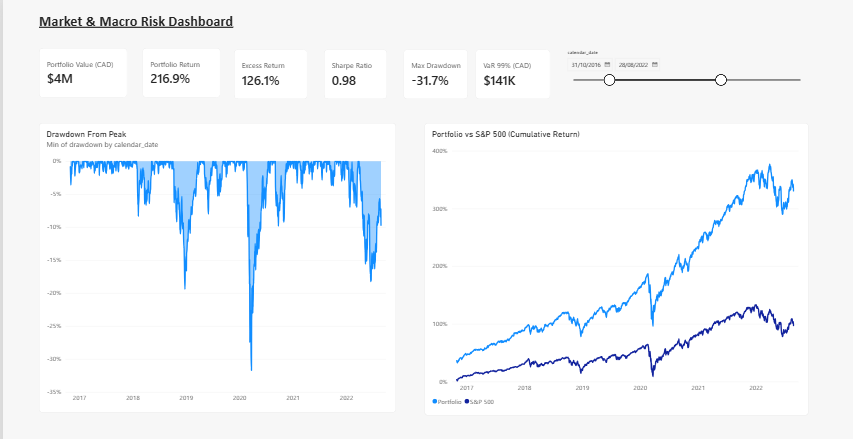
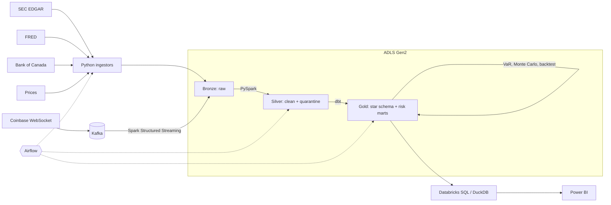

# Market & Macro Risk Analytics Platform

An end-to-end **data engineering + analytics** project: a lakehouse on **Azure + Databricks** that
combines company financials (SEC EDGAR), US and Canadian macro data (FRED, Bank of Canada), daily
equity prices and a **live crypto stream (Kafka + Spark Structured Streaming)**, models it with
**dbt**, computes portfolio risk (**VaR, CVaR, Monte Carlo, backtesting**) in Python, and serves it
to a **Power BI** dashboard.

> It runs fully on a laptop in about 5 minutes with synthetic data (`make demo`, no API keys), and
> on Azure with real data using the same code.


<!-- Add after you build the dashboard:  -->

---

## What it answers

- How much could the portfolio lose tomorrow with 95% / 99% confidence, and **is that VaR model actually right** (backtested with Kupiec's test)?
- Which sectors are most sensitive to **Bank of Canada and Fed rate moves**, the 10-year yield, or USD/CAD?
- Which companies combine strong revenue growth with a reasonable P/E? (TTM fundamentals screener)
- How did the portfolio behave during **yield-curve inversions** and drawdown episodes?

## Architecture



Details and design decisions: [docs/architecture.md](docs/architecture.md)

## Tech stack

| Area | Tools |
|---|---|
| Cloud | Azure: ADLS Gen2, Azure Databricks (Unity Catalog), Key Vault, Event Hubs (optional) |
| Processing | PySpark (batch + Structured Streaming), Kafka (KRaft) |
| Modelling | dbt (DuckDB locally, Databricks in the cloud), SQL |
| Analytics | Python: pandas, NumPy (VaR, Monte Carlo, Kupiec backtest, efficient frontier) |
| Orchestration | Airflow 3, Databricks Asset Bundles |
| Infra & quality | Terraform, Docker Compose, GitHub Actions, pytest, ruff, dbt tests |
| BI | Power BI (star schema, DAX measures, theme) |

## Data sources (all free)

| Source | Data | Notes |
|---|---|---|
| [SEC EDGAR XBRL API](https://www.sec.gov/search-filings/edgar-application-programming-interfaces) | Revenue, net income, assets, debt, EPS for US filers | Needs a User-Agent with your email; ≤ 10 req/s |
| [FRED](https://fred.stlouisfed.org/docs/api/fred/) | Fed funds, 2Y/10Y yields, CPI, unemployment, VIX | Free API key |
| [Bank of Canada Valet](https://www.bankofcanada.ca/valet/docs) | Policy rate, USD/CAD, GoC 10Y yield | No key |
| yfinance | Daily OHLCV, US + TSX tickers | Unofficial; swap for a licensed vendor in production |
| Coinbase Exchange WebSocket | Live BTC/ETH/SOL trades | Public `matches` channel |

The ticker universe, portfolio weights and macro series all live in [`config/settings.yaml`](config/settings.yaml).

---

## Quick start (local, synthetic data)

Requirements: Python 3.11+, Java 17+ (for Spark), Docker (only for Kafka/Airflow).

```bash
python -m venv .venv && source .venv/bin/activate
make install
make demo          # synthetic bronze -> Spark silver -> dbt gold (71 models/tests) -> risk models -> Parquet export
make test          # unit + Spark transformation tests
make docs          # dbt docs + lineage graph at http://localhost:8082
```

Gold tables for Power BI are written to `lake/gold_export/*.parquet`. Synthetic data is labelled
`source = synthetic` everywhere and must not be presented as real market data.

## Real data

```bash
cp .env.example .env      # add FRED_API_KEY and SEC_USER_AGENT
make pipeline             # ingest (SEC, FRED, BoC, prices) -> silver -> gold -> risk -> export
```

## Streaming

```bash
make up                   # Kafka :9092, Kafka UI :8081, Airflow :8080
make stream-produce       # live Coinbase trades -> Kafka   (or: make stream-simulate)
make stream-consume       # Spark: Kafka -> bronze trades + silver 1-minute OHLCV bars
cd dbt && dbt build --profiles-dir . --vars '{enable_streaming: true}'
```

## Deploy to Azure

```bash
cd infra/terraform
cp terraform.tfvars.example terraform.tfvars    # subscription id + alert email
terraform init && terraform apply               # RG, ADLS Gen2, Databricks, Key Vault, budget alerts
terraform output lake_root                      # -> LAKE_ROOT in .env
```

Then in Databricks: create a Unity Catalog storage credential from the access connector, an
external location for the lake, catalog `market_risk`, and a secret scope `mra`. Deploy the jobs:

```bash
cd databricks && databricks bundle deploy -t dev --var lake_root=<abfss url> --var warehouse_id=<id>
```

Set `MRA_RUN_MODE=databricks` in Airflow so the DAG triggers the Databricks job instead of
running Spark locally. **Cost:** set the budget alert first, use the single-node cluster defined
in the bundle, and `terraform destroy` when you're not using it.

---

## Project structure

```
config/settings.yaml          universe, portfolio, series: the single source of truth
src/mra/ingestion/            SEC, FRED, BoC, prices ingestors + synthetic data generator
src/mra/streaming/            Coinbase -> Kafka producer, Spark Structured Streaming consumer
src/mra/processing/           PySpark bronze -> silver jobs (validation, quarantine, dedupe)
src/mra/analytics/            VaR / CVaR / Monte Carlo / Kupiec / efficient frontier
dbt/                          staging -> intermediate -> gold marts, tests, cross-db macros
sql/analysis/                 SQL showcase queries (compiled by dbt)
airflow/dags/                 daily orchestration
infra/terraform/              Azure infrastructure as code
databricks/databricks.yml     Databricks Asset Bundle (jobs)
dashboards/powerbi/           data model, DAX measures, theme, page spec
tests/                        pytest: risk maths + Spark transformations
```

## Data model (gold)

- **Dimensions:** `dim_date`, `dim_company`
- **Facts:** `fct_daily_prices`, `fct_financials_quarterly` (with derived Q4 and TTM), `fct_macro_daily`
- **Risk marts:** `mart_returns_risk` (rolling vol, beta, Sharpe, drawdown), `mart_portfolio_daily`, `mart_portfolio_risk_summary`, `mart_sector_performance`, `mart_fundamentals`
- **Macro marts:** `mart_macro_monthly`, `mart_rate_sensitivity`
- **Python risk outputs:** `risk_var_backtest`, `risk_var_comparison`, `risk_efficient_frontier`, `risk_correlation_matrix`

## Data quality

- **Silver:** rule-based validation with every failed rule recorded; bad rows go to `_quarantine` instead of disappearing. Deduplication on business keys, split detection, SEC restatement flags, YTD-value filtering.
- **Gold:** 50 dbt data tests: uniqueness of grains, referential integrity, value ranges (returns, drawdowns, correlations), VaR consistency, source freshness.
- **Code:** unit tests check the risk maths against analytic answers (e.g. Monte Carlo VaR ≈ 2.326σ for normal data); Spark tests cover dedupe, quarantine, splits, nested-JSON parsing and windowed streaming bars.

## SQL showcase ([`sql/analysis`](sql/analysis))

Sector leaders with `QUALIFY` and `RANK`, drawdown episodes (gaps-and-islands), revenue growth
quartiles with `LAG`/`NTILE`, yield-curve inversion periods, tail-risk percentiles by sector, and
query-optimisation notes (partition pruning, Z-ordering).

## Limitations / next steps

- yfinance is unofficial; production would use a licensed price feed.
- Constant-weight (daily rebalanced) portfolio; transaction costs are ignored.
- TSX companies have prices but no fundamentals (they file on SEDAR+, not EDGAR).
- Ideas: GARCH volatility forecasts, stress scenarios (2020, 2022 rate shock), CDC from a trading database, Great Expectations data docs.

*For education only, not investment advice.*
