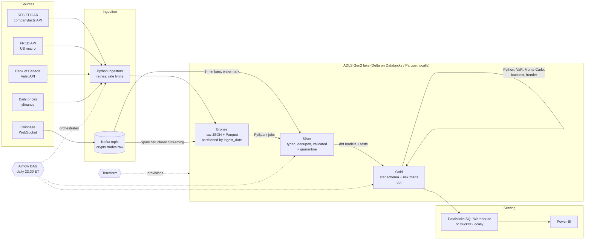

# Architecture

## Layer contracts

| Layer | Format | Written by | Guarantees |
|---|---|---|---|
| Bronze | JSON (API responses in a lineage envelope), Parquet (prices), streaming Parquet/Delta | `mra.ingestion.*`, `stream_consumer` | Immutable, append-only, partitioned by `ingest_date`; replayable |
| Silver | Parquet / Delta, partitioned | `mra.processing.silver_*` (PySpark) | Typed, one row per business key, invalid rows in `_quarantine`, lineage columns |
| Gold | dbt tables (`gold` schema) | dbt + `mra.analytics.run_risk` | Star schema, documented, 50+ data tests, safe to expose to BI |

## Key design decisions

1. **Medallion layout with immutable bronze.** Re-processing after a bug fix means re-running silver/gold from bronze; no API calls needed, no history lost.
2. **Explicit MAP schema for SEC companyfacts.** The JSON uses XBRL concept names as keys. Schema inference would create a struct with thousands of fields; a `MAP<string, struct>` schema plus `explode` keeps it to four clean levels.
3. **Restatements and YTD values handled in silver.** Latest filing wins, `is_restated` preserved; 6/9-month YTD values are filtered by duration; Q4 is derived as FY − (Q1+Q2+Q3) in dbt.
4. **One code base, two runtimes.** `spark_session.py` writes Delta + Unity Catalog tables on Databricks and Parquet locally; dbt macros dispatch the few SQL differences between DuckDB and Spark SQL.
5. **Streaming with event-time watermarks.** Bars are computed on trade time, not arrival time, so late trades still land in the correct minute; checkpoints give exactly-once file output.
6. **Risk models are tested maths.** VaR / CVaR / Monte Carlo / Kupiec are pure functions with unit tests against known analytic answers, separate from I/O.
7. **Cost guardrails.** Single-node job clusters, paused Databricks schedule, bronze → cool storage tier after 30 days, Terraform budget alerts at 50/80/100%.
